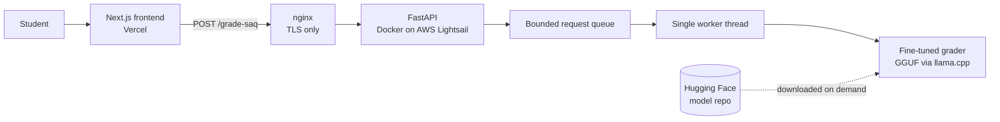

# Intelligrader

AI feedback for AP History short-answer questions (SAQs). A student writes a response and gets a rubric-based score and specific feedback in seconds, without waiting for a teacher. It was demoed to and used by AP History classes at Eleanor Roosevelt High School.

**Live app:** https://intelligrader.vercel.app · **API docs:** https://peral.one/docs

> This repository is a public **showcase** of the system's design and selected source. The working repositories are kept separate.

## How it works



**Endpoints**
- `POST /grade-saq`: `{question, student_answer, rubric, max_score}` returns `{score, max_score, feedback}`
- `POST /generate`: generates a practice SAQ for a topic
- `GET /health`, `GET /models`: liveness and the model registry

## Model
- **In production:** a fine-tuned **Qwen** SAQ grader, quantized to GGUF and run on CPU with llama.cpp.
- **In progress:** a fine-tuned **Gemma-3** grader trained by the team. It will be added as another entry in `models.yaml`, so swapping models needs no code changes.

## Engineering highlights
- **Backpressure instead of overload** ([`api/generation_engine.py`](api/generation_engine.py)): a CPU box can only run one inference at a time, so requests go into a bounded queue served by one worker thread. A full queue returns `429`, a stuck job returns `504`, and a missing model returns `503`. The server never just hangs.
- **Model registry and hot-swapping** ([`api/model_manager.py`](api/model_manager.py), [`api/models.yaml`](api/models.yaml)): models are declared in YAML and validated at startup (unique IDs, exactly one default). They're downloaded from Hugging Face on first use, and at most 3 are kept on disk, with the oldest evicted first. A request can name a model, and the worker swaps it in.
- **Reliable structured output:** the grader is prompted for JSON. The parser falls back to extracting the first `{...}` block, and scores are coerced to integers and clamped to `[0, max_score]`, so a messy generation can't crash the API or return an impossible score.
- **Locked-down edge** ([`deploy/nginx.conf`](deploy/nginx.conf)): HTTPS only, with HSTS and security headers. Requests to the bare IP or an unknown host get no response (`444`), and long proxy timeouts cover slow generations.
- **CI/CD with health-gated deploys** ([`deploy/github-actions-deploy.yml`](deploy/github-actions-deploy.yml)): every push to `main` rebuilds the Docker Compose stack on the server, then polls `/health` until the model reports loaded, and prints container logs if anything fails. A separate staging stack runs on its own subdomain.

## Tech
Python · FastAPI · Pydantic · llama.cpp · Hugging Face Hub · Docker Compose · nginx · GitHub Actions · AWS Lightsail · Next.js · React · Vercel

## Repository layout
```
api/        FastAPI app, generation engine, model registry, request/response schemas
deploy/     Dockerfile, Compose stack, nginx config, CI/CD workflow, health check
frontend/   Client call from the Next.js app to the grading API
```

## Team
Praneet Dumpa · Devom Brahmbhatt
